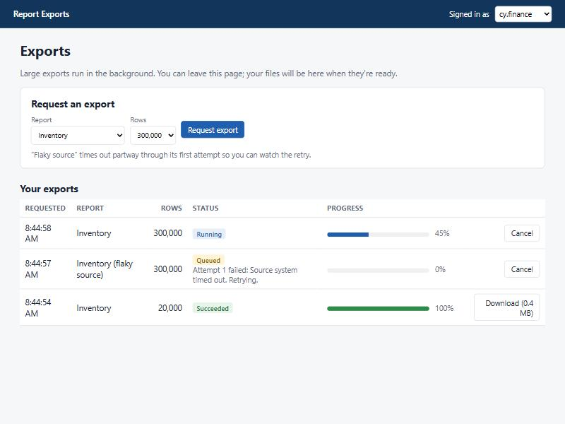

# Background report exports

Large exports used to run inside the web request: the user clicked "Export," the page hung, and the server held a thread (and sometimes a database connection) until the file was built or the request timed out. This project moves that work to a background queue. The request returns in milliseconds, a worker builds the file, and the page shows live progress until the download is ready.

It's a from-scratch rebuild of background download processing I built at work, which took blocking file operations out of the request pipeline. None of that code is reused here.



**Skills:** C# / .NET 9, ASP.NET Core hosted services (`BackgroundService`), Blazor Server, Entity Framework Core, SQL Server, concurrency and cancellation, cookie authentication and authorization, xUnit (18 tests), reliability design.

## Run it

Requires the .NET 9 SDK and SQL Server LocalDB.

```bash
dotnet test
dotnet run --project src/BackgroundExports.Web --launch-profile http -- --reset
```

Open http://localhost:5213. The "Signed in as" picker is a cookie sign-in standing in for single sign-on. Try the "flaky source" export to watch a retry, and stop the app mid-export, then start it again (without `--reset`) to watch it resume.

## How it works

```
Page ──Enqueue──▶ ExportJobs table ◀──claim / progress / result── Worker loops (BackgroundService)
  ▲                       │                                              │
  └──── live refresh ◀── JobNotifier ◀───────────────────────────────────┘
Download endpoint ──checks owner + expiry──▶ App_Data/exports/{id}.zip
```

## Design decisions

### The database is the queue
An in-memory queue (a `Channel<T>`) is simpler, but it forgets everything when the app restarts, and on a campus server a deploy or patch reboot will eventually land mid-export. Here each request is a row in `ExportJobs`, and that row is the source of truth. The in-memory `JobSignal` only wakes idle workers early. If it were removed, workers would still find the job on their 5-second poll.

### Surviving a restart
A job still marked `Running` when the app starts was interrupted. `RecoverInterruptedAsync` puts it back in the queue and refunds the attempt it lost, since an interrupted job didn't fail. I verified this in the running app by killing the server at 10% of a 300,000-row export. On restart it logged "Requeued 1 exports interrupted by the last shutdown" and finished with one attempt recorded.

### Two workers, one job
Workers claim the oldest queued job by setting it to `Running` and changing its `ClaimToken`, an EF Core concurrency token. If two workers (or two servers behind a load balancer) read the same job, only the first save succeeds. The other gets a concurrency exception and moves on, so nothing is ever exported twice.

### Retries only for failures worth retrying
A `TransientExportException` (a timeout, a busy source system) goes back in the queue with exponential backoff: 5 s, then 10 s, up to 3 attempts. Anything else fails immediately, because retrying a bug three times only wastes three times the work. Users see a safe summary; exception details go to the log, never to the page (a test plants a password in an exception message and checks it doesn't leak).

### Cancellation that actually stops work
Canceling a queued job marks it canceled and bumps its claim token, so a worker that read it a moment ago can't start it. Canceling a running job trips that job's `CancellationToken` immediately. The worker also checks a database flag whenever it saves progress, which is how a cancel reaches a job running on a different server. Partial files are always deleted.

### Fair use and cleanup
Each person can have three exports queued or running at once, so one user can't fill the queue for everyone. Finished files expire after 24 hours and an hourly cleanup deletes them.

### Only you can download your export
Pages and the download endpoint read the same signed-in user. The endpoint returns 404 for someone else's export, checked live with a second user. Downloads stream from disk with range support instead of going through the Blazor connection.

### Live progress without hammering the database
Workers save progress at most once per 5% and publish an in-process event. Each open page coalesces those events into at most one refresh every 250 ms.

## Tests

`dotnet test` runs 18 tests against SQLite in memory with a controllable clock:

- end to end: request → worker → ZIP with every row → download
- oldest-first ordering, per-user limit, input validation, owner-only download
- retry with backoff timing, giving up after three attempts, immediate failure for bugs without leaking details
- cancel queued, cancel running (no leftover files), other users can't cancel
- shutdown mid-export followed by recovery, two workers racing for one job
- result expiry deletes files

## What I'd change at larger scale
- For many servers or very high volume, a dedicated queue (Azure Service Bus, or Hangfire on SQL Server) instead of polling a table.
- Push progress to the browser with SignalR groups per user, so several web servers can share one set of workers.
- Store results in blob storage with short-lived signed URLs instead of local disk.

Built with AI assistance (Claude Code). I set the requirements and failure cases, reviewed the code, and tested each behavior in the running app, including the restart.
